# Microservices Shop

**English** · [Türkçe](README.tr.md)

An online coffee and tea shop split into six .NET services behind a YARP gateway, with no shared database. Identity, Catalog, Basket, Inventory, Ordering and Payment each own their data and talk through RabbitMQ. An order is a saga that Ordering orchestrates: hold the stock, take the payment, confirm, and undo whatever was done when something fails. The point of the project is that the order is always consistent: it ends up paid with its stock held, or nothing is held and nothing is charged. That holds when customers race for the last units, a message arrives twice, or a service goes down halfway through.

[](https://github.com/Beratoguzhan620/microservices-shop/actions/workflows/ci.yml)


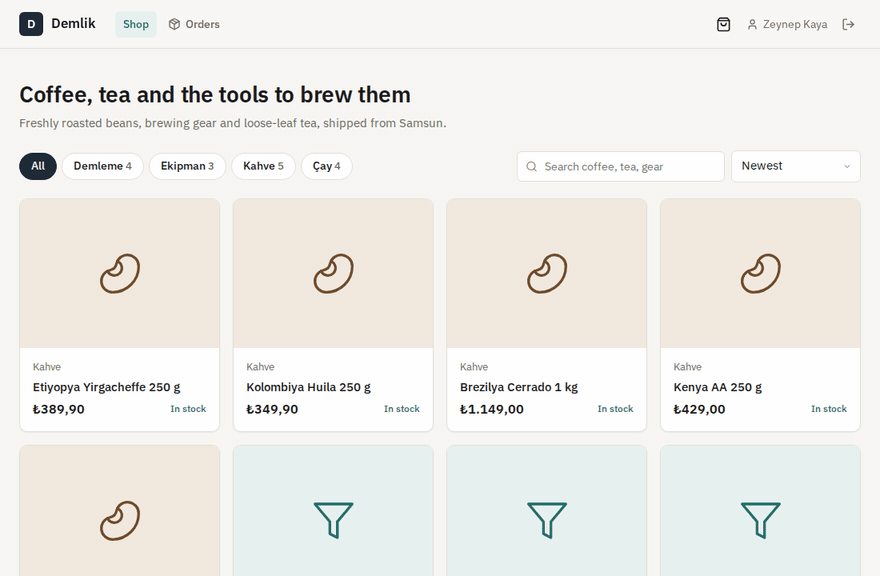

## Try it

```bash
docker compose up --build
```

This starts PostgreSQL (one database per service), Redis, RabbitMQ, Jaeger, the six services, the gateway and nginx with the storefront. Open http://localhost:8080, create an account and buy something. The catalog comes with 16 products and 25 of each in stock.

- Test cards: `4242 4242 4242 4242` is approved, `4000 0000 0000 0002` is declined, `4000 0000 0000 9995` has insufficient funds, and `4000 0000 0000 0077` never answers, so the order times out after 60 seconds. Use any future expiry and any CVC.
- The shop's admin: `admin@shop.local` / `admin-password-change-me` (set `ADMIN_EMAIL` and `ADMIN_PASSWORD` in `.env` to change them; see `.env.example`).
- API reference for every service through the gateway: http://localhost:8080/scalar
- Traces across services in Jaeger: http://localhost:16686 · RabbitMQ console: http://localhost:15672 (shop / shop-local)

## Features

- **Storefront:** categories, search, sorting, product pages with live stock, a basket that survives sign-out, and checkout with a delivery address and a card. Prices in Turkish lira.
- **Checkout that never charges a surprise:** the basket is priced again from the catalog at checkout. If a price changed or a product was archived since it was added, nothing is ordered, and the customer sees what changed and the new total to accept.
- **Order tracking:** the order page follows the saga live: stock held, payment, confirmed, shipped with a tracking code. A failed order shows the reason and says that nothing was charged.
- **Cancellation and refunds:** an order can be cancelled until it ships. The stock goes back on the shelf and the payment is refunded.
- **Payment:** a fake card provider behind a tokenization step, so the card number never travels with the order. Tokens are checked with Luhn and expiry; test cards decide the outcome; only the last four digits are kept.
- **Stock:** stock on hand, held for orders in progress, and available. Holding stock is all-or-nothing for an order. The admin counts stock, but never below what is held.
- **Admin:** orders by status with a ship action that takes a tracking code; products with prices, archive and restore; stock with counts. Saving an outdated product or stock count is refused with a clear message.
- **Accounts:** sign-up and sign-in with RS256 tokens; the Admin role on the admin account, seeded from configuration.
- **Gateway:** one address for everything. It checks tokens before forwarding, routes to the services, limits requests per client (with a stricter limit on sign-in), passes correlation ids and reports the health of the services behind it.
- **Observability:** OpenTelemetry traces from the gateway through HTTP calls, RabbitMQ messages and SQL, in Jaeger; structured logs with correlation ids, with emails and card numbers masked.

## Screenshots

| The catalog | A product |
|---|---|
| 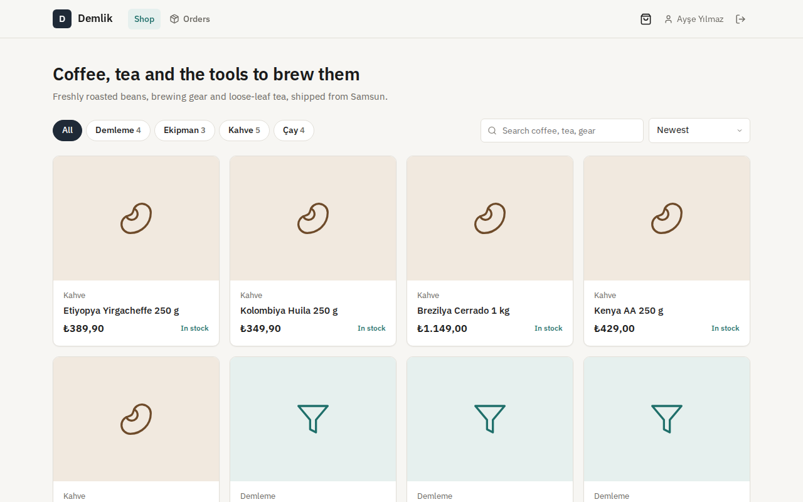 | 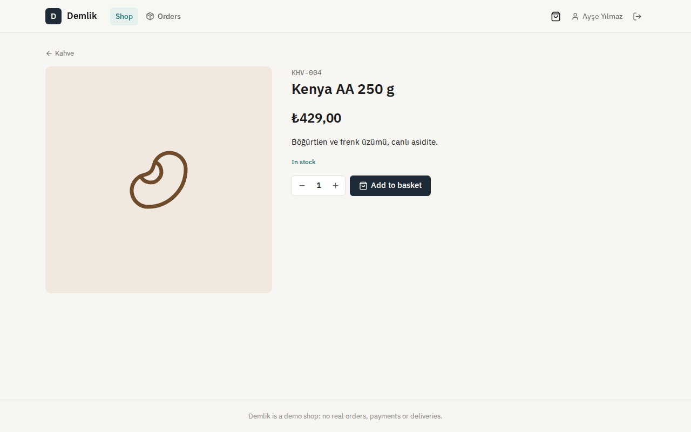 |
| **Checkout** | **The order, paid** |
| 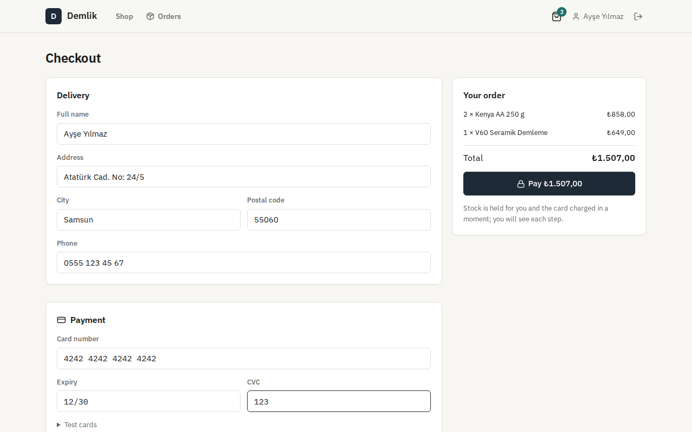 | 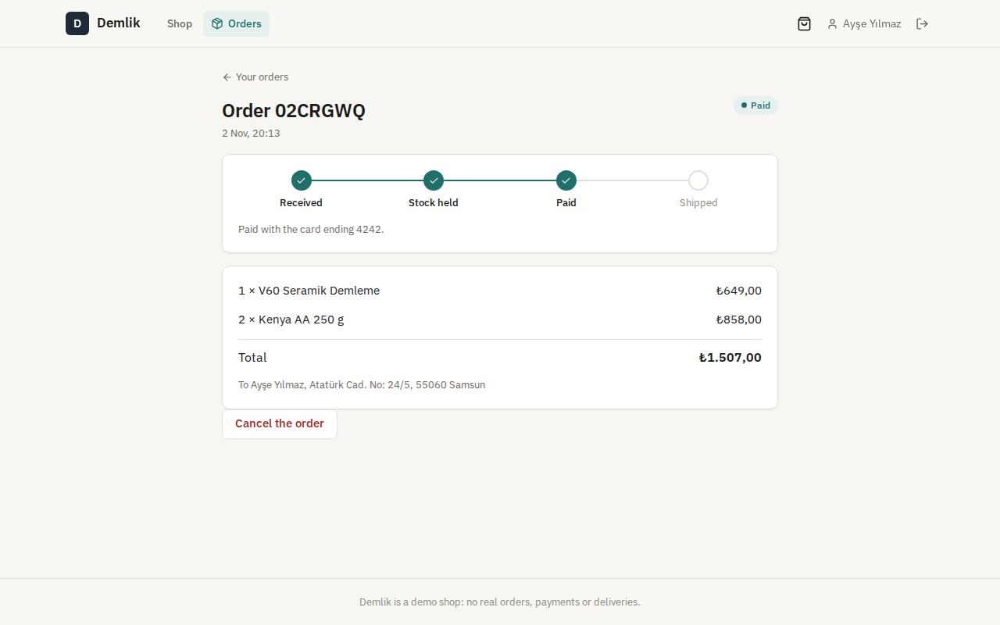 |
| **Shipped, with a tracking code** | **A declined card** |
| 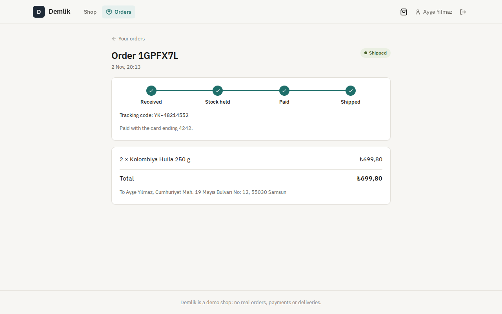 | 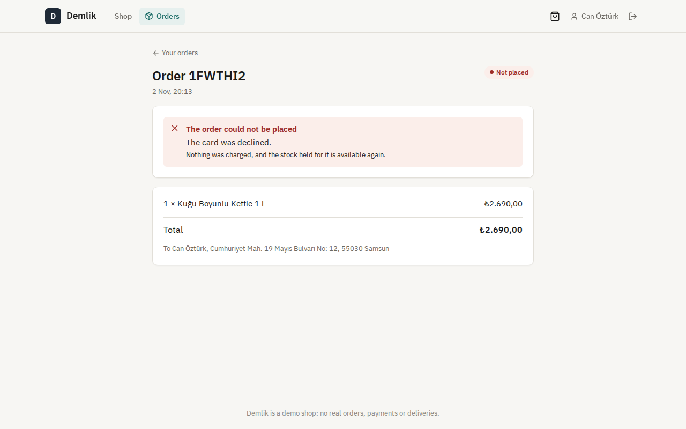 |
| **Admin: orders** | **Admin: stock** |
| 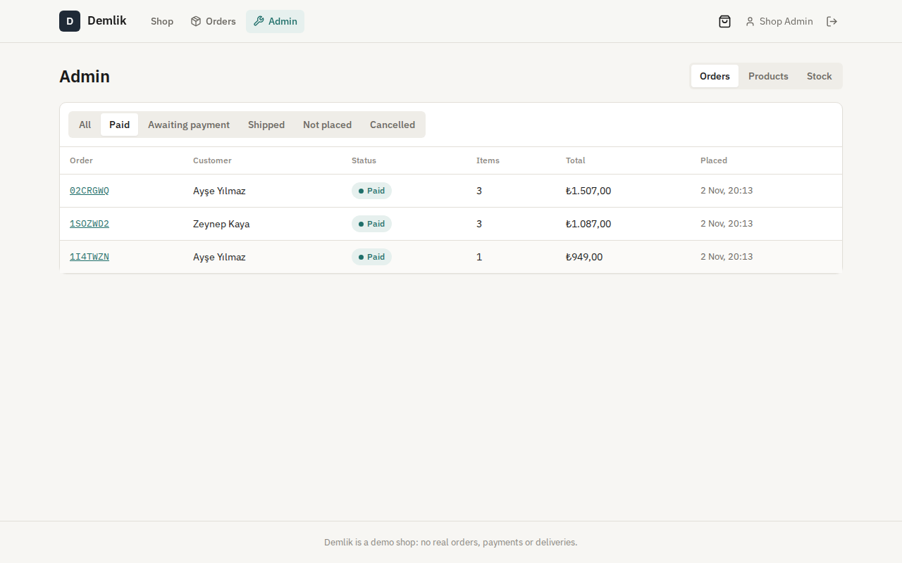 | 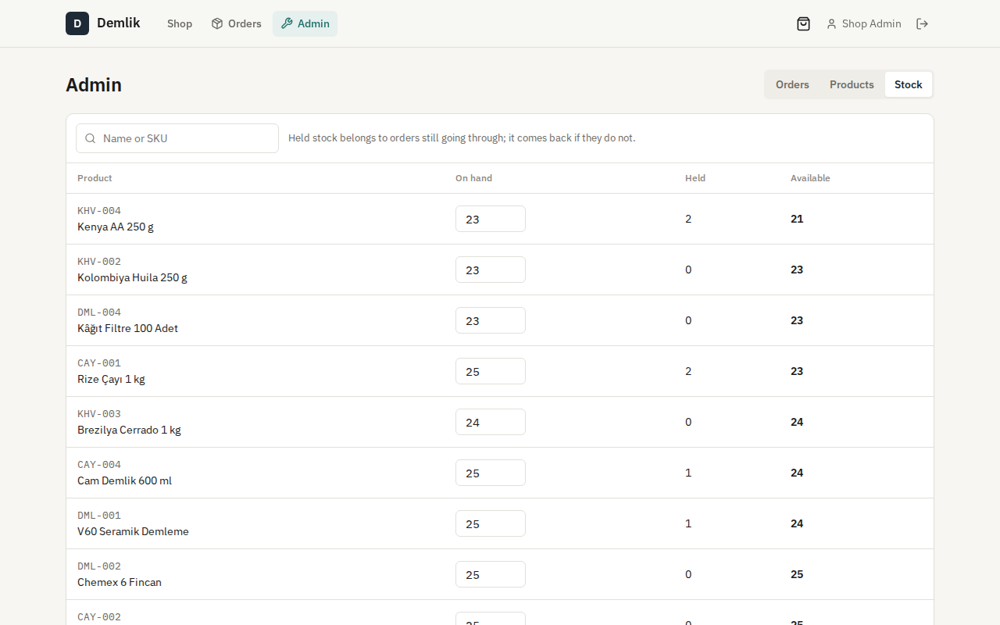 |
| **One checkout traced across the services** | **API reference** |
| 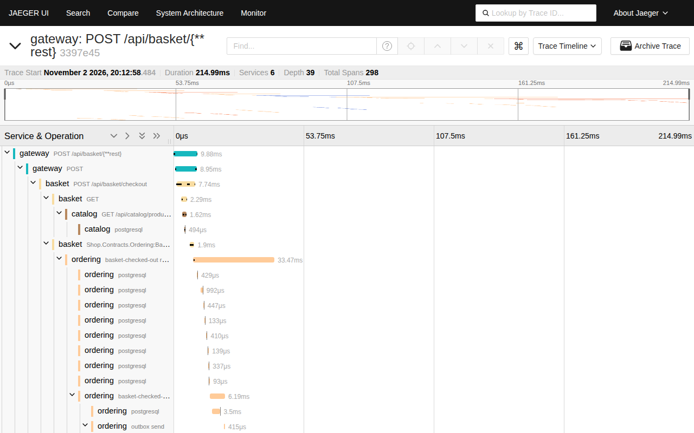 | 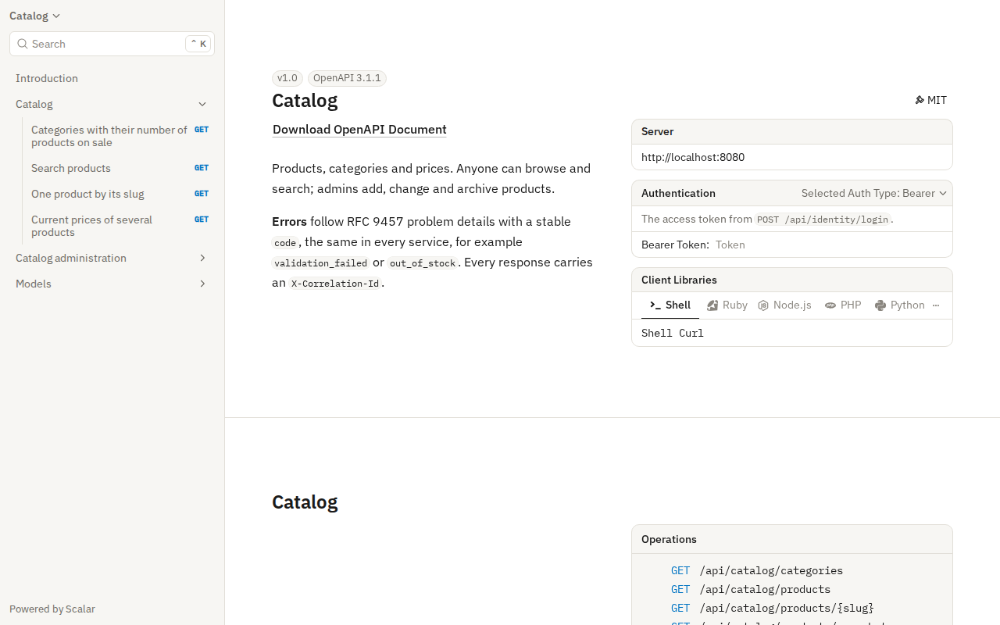 |
| **On a phone** | **An order on a phone** |
| 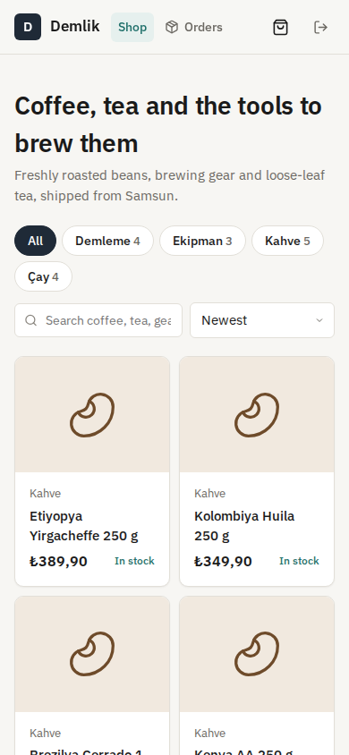 | 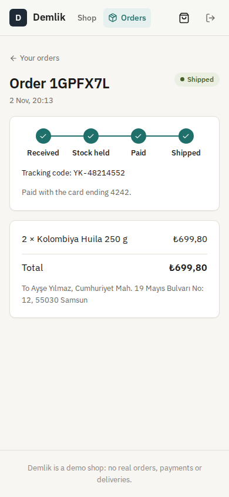 |

## Resilience, measured

Measured in CI on a standard GitHub runner by `tests/resilience/run.sh`, against the whole Compose stack with the load client on the same machine.

| Scenario | Result |
|---|---|
| 60 customers check out the last 10 units of one product at the same moment | exactly 10 confirmed and 50 rejected as out of stock, none of them charged; afterwards 10 held and 0 available. Everything settled in 5.8 s |
| Checkout answer during that rush | p50 76 ms, p95 152 ms (the order is accepted; the saga runs after) |
| From checkout to confirmed | one order on its own: 121 ms. In the rush: p50 4.7 s, p95 5.2 s, as the orders queue for the same stock row |
| Ordering stopped while 15 orders are placed, started again 10 seconds later | every checkout still answered (p50 44 ms) and waited in RabbitMQ; all 15 confirmed once Ordering was back |
| Payment stopped while 15 orders wait to be charged, started again 15 seconds later | the orders held their stock and waited; all 15 confirmed once Payment was back |

## Tech stack

- ASP.NET Core 10: minimal APIs, ProblemDetails, OpenAPI with Scalar, JWT bearer with RS256, rate limiting, health checks
- YARP 2 as the gateway
- RabbitMQ with MassTransit 8: a saga state machine stored with EF Core, transactional outbox and inbox, retries
- PostgreSQL 17 with Entity Framework Core 10 (Npgsql), one database per service, optimistic concurrency with `xmin`, migrations
- Redis for baskets
- OpenTelemetry and Jaeger; Serilog
- React 18, TypeScript and Vite; Lucide icons and IBM Plex; nginx
- xUnit, Testcontainers (real PostgreSQL, Redis and RabbitMQ), Vitest, Playwright
- GitHub Actions: warnings as errors, .NET and web tests, pending-migration check for every service, Compose smoke test, browser walkthrough, resilience checks
- Docker / Docker Compose

## Architecture

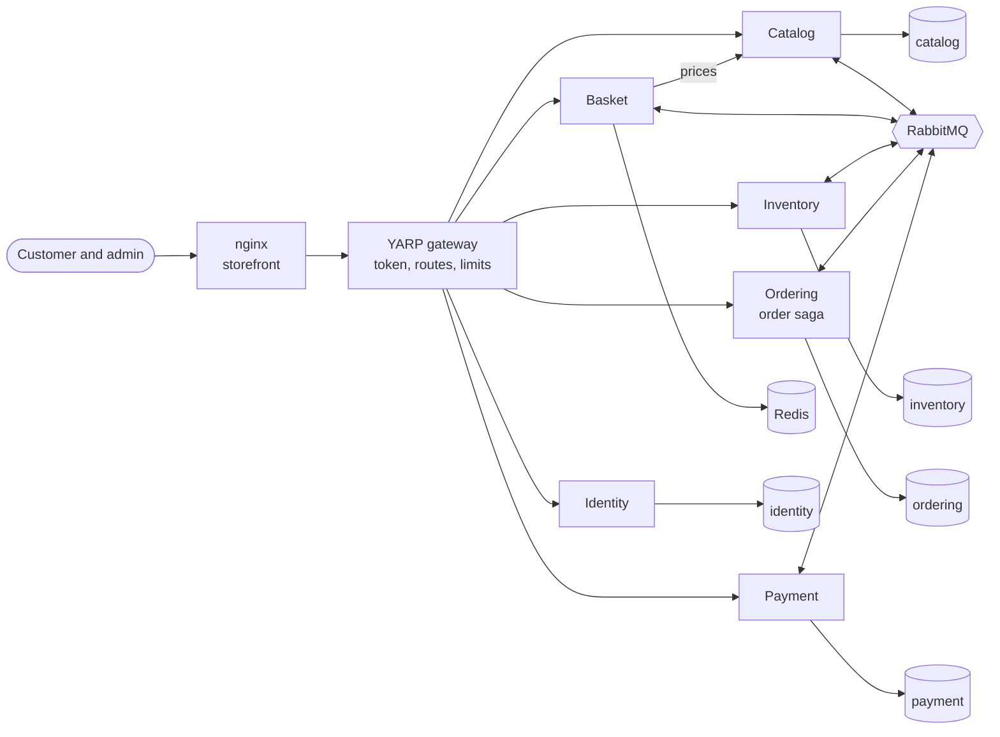

Each service has its own PostgreSQL database (in Compose, on one server). Only Basket calls another service directly, to price the basket. Everything else goes through RabbitMQ.

The order saga, as Ordering runs it:

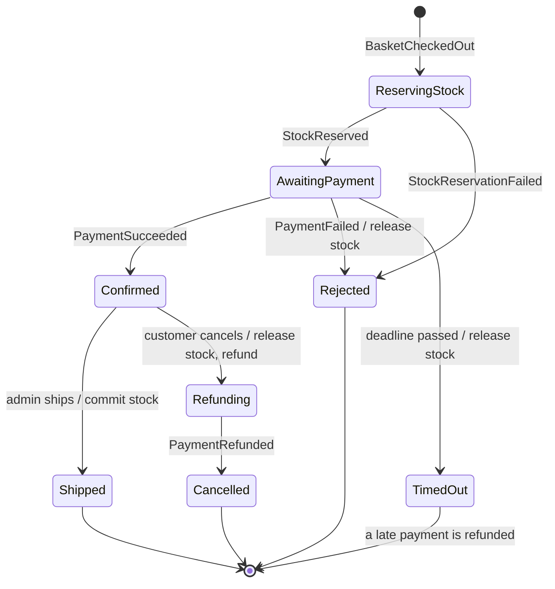

One checkout, end to end:

```mermaid
sequenceDiagram
    participant C as Customer
    participant B as Basket
    participant O as Ordering (saga)
    participant I as Inventory
    participant P as Payment
    C->>P: POST /cards (card number) → token
    C->>B: POST /checkout (address, total shown, token)
    B->>B: price again from Catalog; take the basket
    B-)O: BasketCheckedOut (outbox)
    B-->>C: 202 order id
    O-)I: ReserveStock
    I-)O: StockReserved (all lines, or none)
    O-)P: ProcessPayment
    P-)O: PaymentSucceeded (card ending 4242)
    O-->>C: the order page shows "Paid"
```

## Design decisions

- **A database per service, no shared tables.** A service reads its own data and learns about the others from events. Inventory learns about new products from `ProductCreated` and keeps its own name and SKU, so the stock page needs no call to Catalog.
- **An orchestrated saga instead of a chain of events.** The order's whole process is one MassTransit state machine in Ordering, stored in its database. The happy path, every compensation (release the stock, refund the payment) and the timeout can be read in one file. Inventory and Payment only answer commands and know nothing about orders' states.
- **The outbox: a change and its messages commit together.** Every service writes outgoing messages to an outbox table in the same transaction as its own change, and a background delivery sends them on. A crash between "saved" and "sent" cannot lose a message or send one for a change that was rolled back. Basket, which has no database, takes the basket out of Redis in one atomic step (`GETDEL`), so two checkouts at the same moment place one order. It puts the basket back if the publish fails.
- **Idempotent consumers.** The inbox drops a message that was already handled. On top of that, every handler is safe to run twice: holding stock for an order that already has a hold does nothing, and a payment for an order is unique, so a repeated `ProcessPayment` answers with the first result instead of charging again.
- **No overselling, by locking the rows that matter.** Holding stock locks the order's stock rows (`SELECT … FOR UPDATE`, in a fixed order to avoid deadlocks), checks every line, and holds all of them or none. A check constraint keeps the hold from ever exceeding the stock on hand, even if the code were wrong.
- **Held, then committed.** Stock is held when the order is placed and taken off the shelf when it ships. A cancelled, declined or timed-out order releases its hold, so the shelf count only moves for goods that left.
- **Timeouts that do not depend on a message.** An order waiting for payment has a deadline in its saga row. A sweeper in Ordering finds orders past their deadline and moves them to timed out, releasing the stock. A payment that turns up after that is refunded automatically.
- **The price the customer saw is the price they pay.** Checkout sends the total the customer was shown. Basket prices the lines again from Catalog, and if anything differs, it answers `409` with the changes instead of ordering. Orders keep a snapshot of names and prices, so changing the catalog later does not rewrite history.
- **Cards are tokenized first.** The browser sends the card to Payment and gets back a short-lived token. The basket, the order and the messages only ever carry the token, and only the last four digits are kept.
- **One gateway, asymmetric tokens.** Identity signs tokens with an RSA private key that only it holds. The gateway and the services validate with the public key, so a compromised service cannot mint tokens. The gateway rejects unauthenticated calls before they reach a service, and each service still checks the token and the role itself.
- **Failures are retried, then stop.** Message handlers retry at 0.1, 0.5, 1, 2 and 5 seconds. A message that still fails goes to an error queue instead of blocking the others. HTTP from Basket to Catalog has timeouts, retries and a circuit breaker. If Catalog is down, checkout answers `503` and the basket is kept.
- **Connection pools sized for a shared server.** The rush above first failed with PostgreSQL out of connections: five services with the default pool of 100 each, against a server allowing 100. In Compose each service now keeps at most 30 connections and the server allows 200. The test stays in CI so this cannot come back unnoticed.
- **Tests with the real infrastructure.** Integration tests run each service against PostgreSQL, Redis and RabbitMQ in Testcontainers. The saga tests run on a real RabbitMQ with a fake clock, so timeouts are tested without waiting.

## Commands

| Command | What it does |
|---|---|
| `docker compose up --build` | The whole shop on http://localhost:8080 |
| `dotnet test` | .NET unit and integration tests (Docker needed for Testcontainers) |
| `cd web && npm install && npm test` | Storefront unit tests |
| `cd web && npm run dev` | The storefront with hot reload on http://localhost:5173, against the gateway on port 8080 |
| `cd tests/e2e && npm install && node shop.mjs` | The browser walkthrough against a running stack started with `AUTH_ATTEMPTS_PER_MINUTE=1000` |
| `bash tests/resilience/run.sh` | The resilience checks against a running stack started with `AUTH_ATTEMPTS_PER_MINUTE=100000 REQUESTS_PER_MINUTE=100000` |
| `dotnet ef migrations add <Name> --project src/Services/<Service>/Shop.<Service> --output-dir Data/Migrations` | Add a migration to one service |

For a local run outside Compose, each service reads its connection string and keys from user secrets or environment variables, never from the repository. `deploy/keys.sh` creates the RSA key pair that Compose generates on start.

## Tests

132 tests and two runs against the whole stack: 125 .NET unit and integration tests, 7 Vitest tests for the storefront, a 13-step Playwright walkthrough, and the resilience checks, all in CI.

- **Identity:** sign-up, sign-in with the same answer for any mistake, RS256 tokens that check out with the public key, the admin seeded from configuration, masking of emails and card numbers in logs.
- **Catalog:** search, filters, sorting and paging, slugs, archived products hidden from customers, admin changes with version checks, `ProductCreated` through the outbox.
- **Basket:** quantities and totals, prices from Catalog, checkout refused with the changes when prices moved, two checkouts at the same moment placing one order, address and card validation, nothing ordered and the basket kept when Catalog is down.
- **Inventory:** opening stock for new products, holding all lines or none, twenty parallel orders for the last five units selling exactly five, release and commit, repeated messages holding nothing twice, counts that cannot go below what is held.
- **Ordering:** the saga on a real RabbitMQ: paid, out of stock, declined with the stock given back, a payment timeout with a late payment refunded, cancellation with a refund, shipping with the stock committed, a checkout or a payment answer delivered twice, and orders only visible to their owner.
- **Payment:** card tokens (Luhn, expiry, one use, one customer, half an hour), test cards, one charge per order even when asked twice, a refund once and only for a payment that went through.
- **Gateway:** routing, tokens checked before forwarding, unknown paths not forwarded, the sign-in limit, correlation ids, every service's API document, and readiness naming the service that is down.
- **Storefront (Vitest):** money in lira, card formatting, expiry parsing, order progress.
- **Browsers (CI):** browsing and search, sign-up from the basket, quantities, paying, a declined card, the admin shipping with a tracking code, the customer seeing it, cancelling with a refund, a price change shown before paying, counting stock, customers kept out of the admin, the phone layout, and no script errors.
- **Resilience (CI):** the table above.

## Roadmap and known gaps

- Real payments through a provider's sandbox; the card provider here is a fake with test cards.
- Order emails, through the [notification-service](https://github.com/Beratoguzhan620/notification-service).
- Partial shipments and returns after shipping.
- Search through a search engine instead of PostgreSQL `ILIKE`.
- Kubernetes manifests; Compose runs one copy of everything on one machine.
- The rate limits live in the gateway's memory; with several gateways they would move to Redis.

## License

[MIT](LICENSE) · Berat Oğuzhan Turğut · [GitHub](https://github.com/Beratoguzhan620)
