# Microservices Shop

[English](README.md) · **Türkçe**

Ortak veritabanı olmadan, YARP ağ geçidinin arkasında altı .NET servisine bölünmüş bir kahve ve çay mağazası. Identity, Catalog, Basket, Inventory, Ordering ve Payment kendi verilerine sahip ve RabbitMQ üzerinden konuşuyor. Sipariş, Ordering'in yönettiği bir saga: stoğu ayır, ödemeyi al, onayla; bir şey ters giderse yapılanı geri al. Projenin amacı, siparişin her zaman tutarlı kalması: ya ödenmiş ve stoğu ayrılmış olur ya da ne stok tutulur ne para çekilir. Müşteriler son ürünler için yarıştığında, bir mesaj iki kez geldiğinde ya da bir servis işin ortasında çöktüğünde de bu böyle kalır.

[](https://github.com/Beratoguzhan620/microservices-shop/actions/workflows/ci.yml)


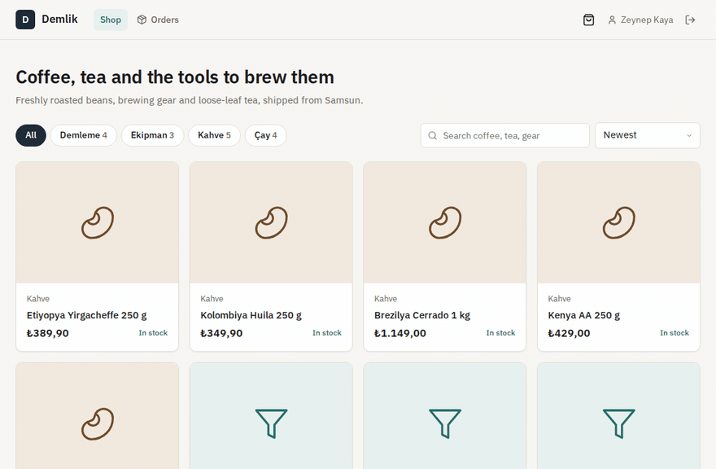

## Deneyin

```bash
docker compose up --build
```

Bu komut PostgreSQL'i (her servise bir veritabanı), Redis'i, RabbitMQ'yu, Jaeger'ı, altı servisi, ağ geçidini ve mağaza arayüzüyle nginx'i başlatır. http://localhost:8080 adresini açın, hesap oluşturun ve bir şey satın alın. Katalog 16 ürünle ve her birinden 25 adet stokla gelir.

- Test kartları: `4242 4242 4242 4242` onaylanır, `4000 0000 0000 0002` reddedilir, `4000 0000 0000 9995` bakiye yetersiz der, `4000 0000 0000 0077` hiç cevap vermez ve sipariş 60 saniye sonra zaman aşımına düşer. Son kullanma tarihi olarak ileri bir tarih, CVC olarak herhangi bir değer yeter.
- Mağaza yöneticisi: `admin@shop.local` / `admin-password-change-me` (değiştirmek için `.env` içinde `ADMIN_EMAIL` ve `ADMIN_PASSWORD` verin; bkz. `.env.example`).
- Ağ geçidi üzerinden tüm servislerin API dokümanı: http://localhost:8080/scalar
- Servisler arası izler Jaeger'da: http://localhost:16686 · RabbitMQ konsolu: http://localhost:15672 (shop / shop-local)

## Özellikler

- **Mağaza:** kategoriler, arama, sıralama, canlı stok bilgisiyle ürün sayfaları, oturum kapansa da kaybolmayan bir sepet, teslimat adresi ve kartla ödeme. Fiyatlar Türk lirası.
- **Sürprizsiz ödeme:** ödeme anında sepet katalogdan yeniden fiyatlanır. Ürün sepete eklendikten sonra fiyatı değiştiyse ya da satıştan kaldırıldıysa hiçbir şey sipariş edilmez; müşteri neyin değiştiğini ve onaylayacağı yeni toplamı görür.
- **Sipariş takibi:** sipariş sayfası sagayı canlı izler: stok ayrıldı, ödeme, onaylandı, takip koduyla kargoda. Başarısız bir sipariş nedenini ve hiçbir ücret alınmadığını gösterir.
- **İptal ve iade:** sipariş kargoya verilene kadar iptal edilebilir. Stok rafa döner, ödeme iade edilir.
- **Ödeme:** kart numarası siparişle birlikte dolaşmasın diye tokenizasyon adımının arkasında sahte bir kart sağlayıcı. Token'lar Luhn ve son kullanma tarihiyle denetlenir; sonucu test kartları belirler; yalnızca son dört hane saklanır.
- **Stok:** eldeki stok, süren siparişler için ayrılan ve satılabilir miktar. Bir siparişin stoğu ya tamamen ayrılır ya hiç ayrılmaz. Yönetici sayım girer ama ayrılan miktarın altına inemez.
- **Yönetim:** duruma göre siparişler ve takip kodu isteyen kargoya ver işlemi; fiyatlarıyla ürünler, arşivleme ve geri alma; sayımlarıyla stok. Eskimiş bir ürün ya da stok sayımı kaydedilmek istenirse açık bir mesajla reddedilir.
- **Hesaplar:** RS256 token'larla kayıt ve giriş; Admin rolü yapılandırmadan oluşturulan yönetici hesabında.
- **Ağ geçidi:** her şey için tek adres. İsteği iletmeden önce token'ı doğrular, servislere yönlendirir, istemci başına istekleri sınırlar (girişte daha sıkı), korelasyon kimliklerini taşır ve arkasındaki servislerin sağlığını raporlar.
- **Gözlemlenebilirlik:** ağ geçidinden HTTP çağrıları, RabbitMQ mesajları ve SQL boyunca OpenTelemetry izleri, Jaeger'da; korelasyon kimlikli, e-posta ve kart numaraları maskelenmiş yapısal loglar.

## Ekran görüntüleri

| Katalog | Bir ürün |
|---|---|
| 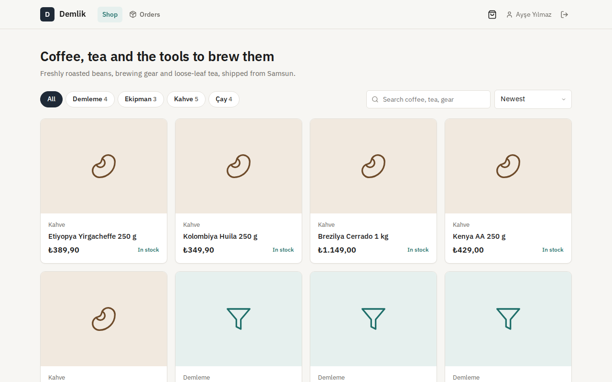 | 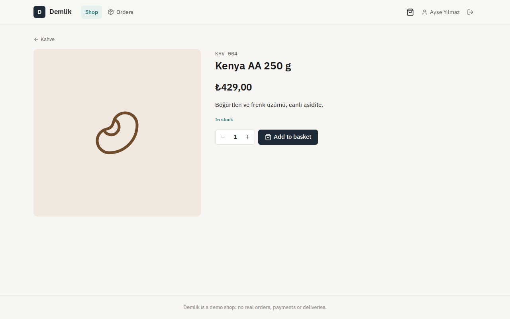 |
| **Ödeme** | **Ödenmiş sipariş** |
| 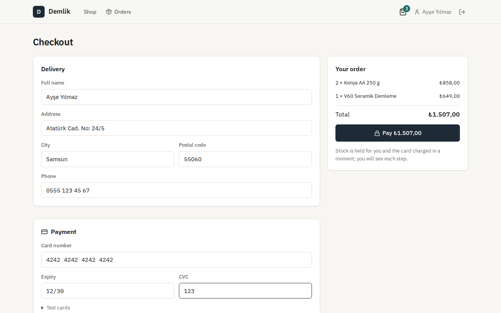 | 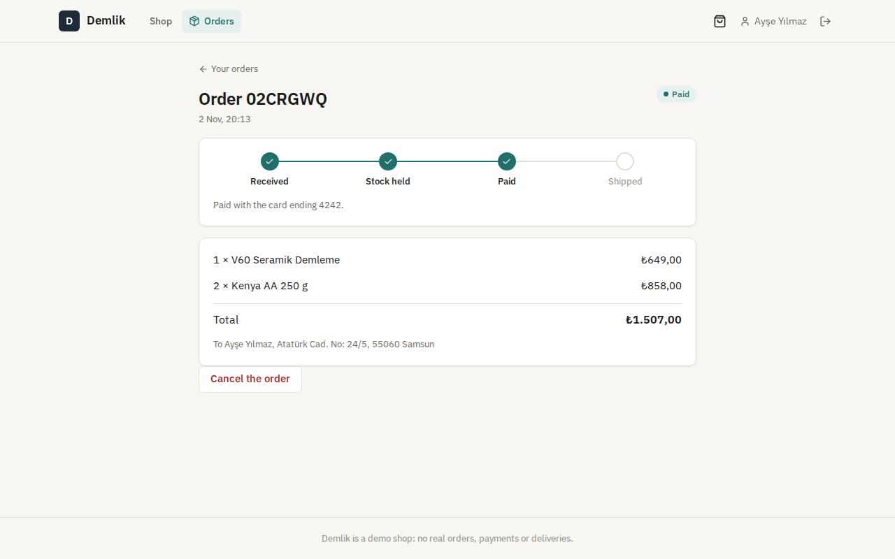 |
| **Takip koduyla kargoda** | **Reddedilen kart** |
| 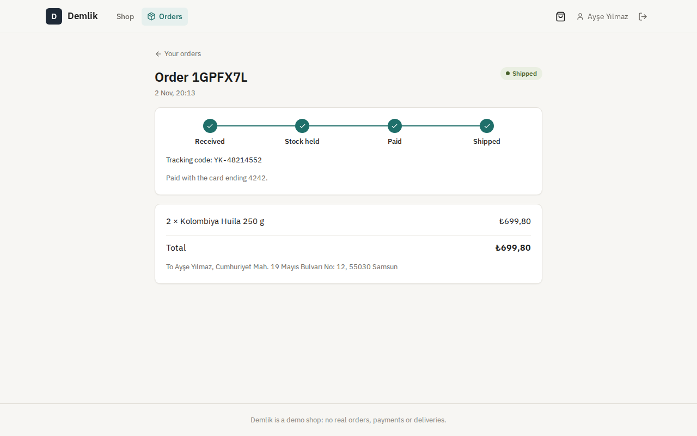 | 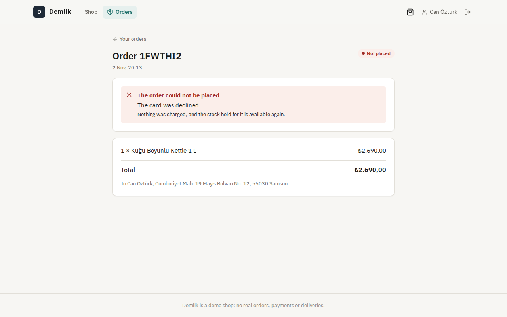 |
| **Yönetim: siparişler** | **Yönetim: stok** |
| 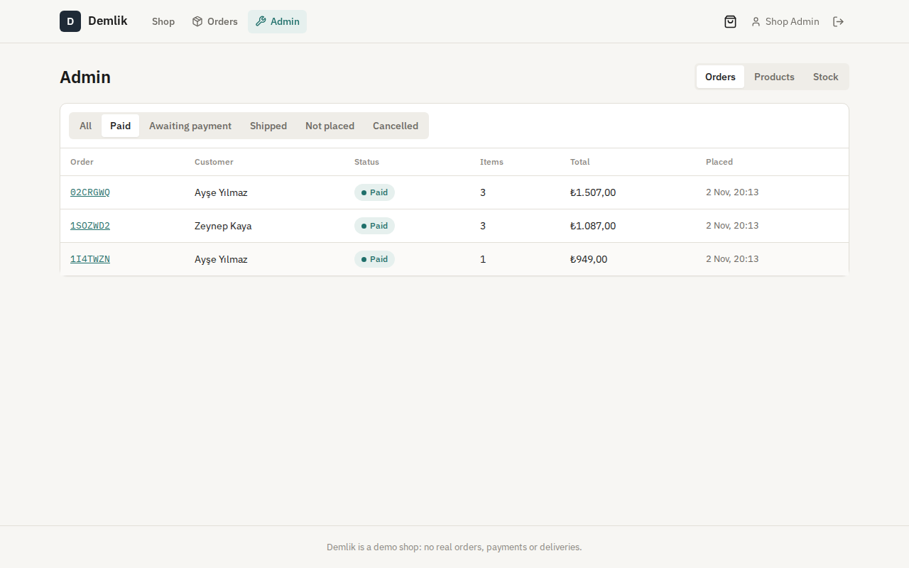 | 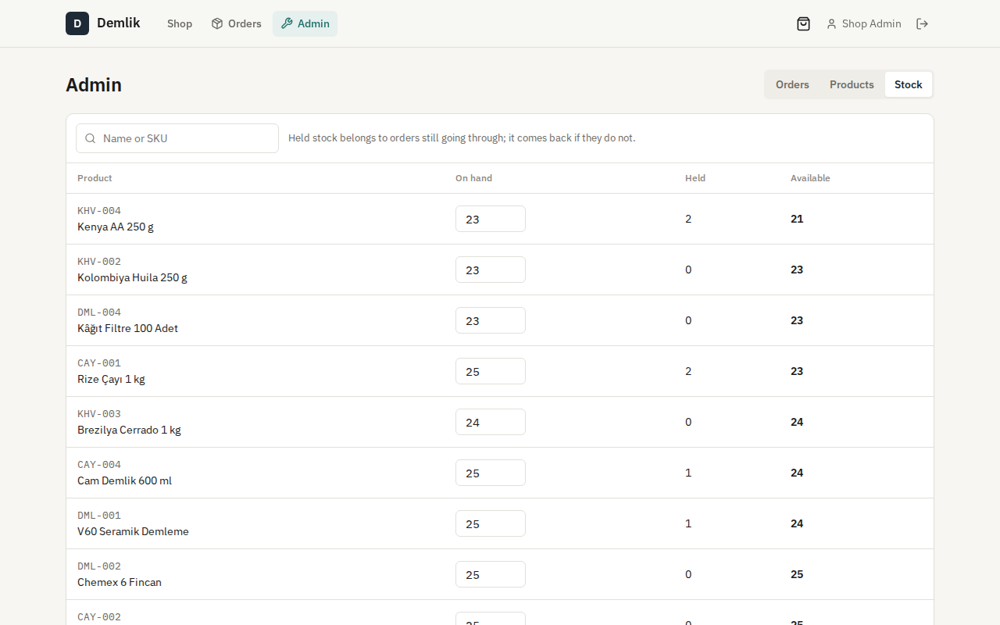 |
| **Bir ödemenin servisler boyunca izi** | **API dokümanı** |
| 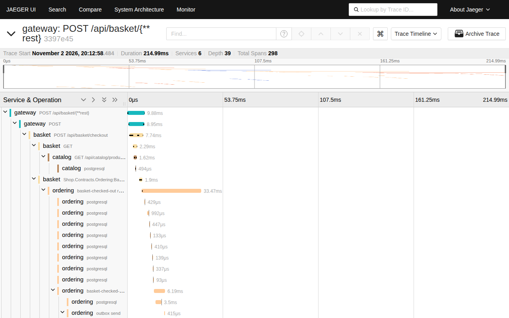 | 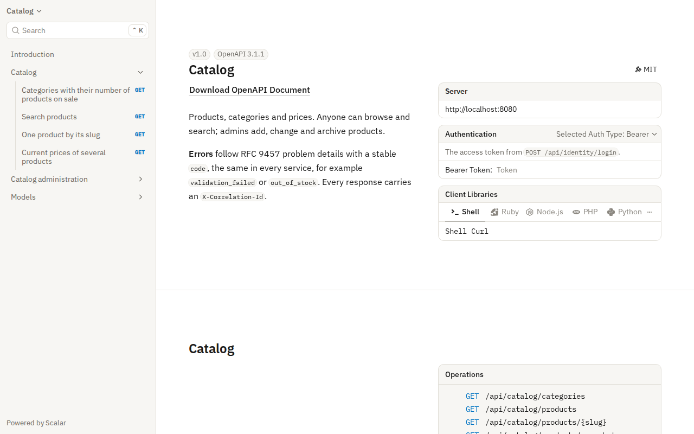 |
| **Telefonda** | **Telefonda bir sipariş** |
| 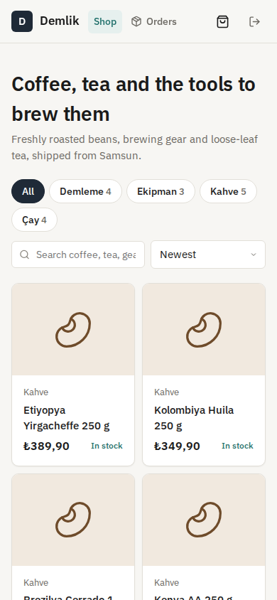 | 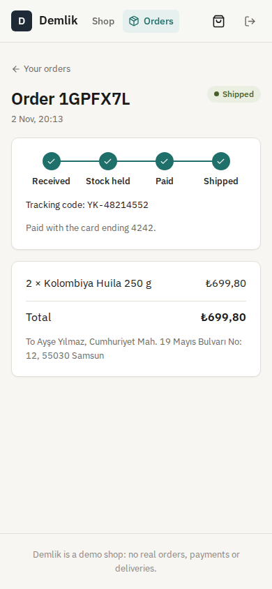 |

## Ölçülmüş dayanıklılık

Standart bir GitHub sunucusunda CI içinde `tests/resilience/run.sh` ile, Compose yığınının tamamına karşı ve yük istemcisi aynı makinedeyken ölçüldü.

| Senaryo | Sonuç |
|---|---|
| 60 müşteri aynı anda bir ürünün son 10 adedi için ödeme yapıyor | tam 10 sipariş onaylandı, 50'si stok yok diye reddedildi ve hiçbirinden para çekilmedi; sonrasında 10 ayrılmış, 0 satılabilir. Hepsi 5,8 sn'de sonuçlandı |
| O yoğunlukta ödeme isteğinin cevabı | p50 76 ms, p95 152 ms (sipariş kabul edilir; saga ardından çalışır) |
| Ödemeden onaya | tek başına bir sipariş: 121 ms. Yoğunlukta: p50 4,7 sn, p95 5,2 sn; siparişler aynı stok satırı için sıraya girer |
| 15 sipariş verilirken Ordering durduruldu, 10 saniye sonra yeniden başlatıldı | tüm ödeme istekleri yine cevaplandı (p50 44 ms) ve RabbitMQ'da bekledi; Ordering geri gelince 15'i de onaylandı |
| 15 sipariş ödeme beklerken Payment durduruldu, 15 saniye sonra yeniden başlatıldı | siparişler stoklarını tutup bekledi; Payment geri gelince 15'i de onaylandı |

## Teknolojiler

- ASP.NET Core 10: minimal API'ler, ProblemDetails, Scalar ile OpenAPI, RS256 JWT bearer, hız sınırlama, sağlık kontrolleri
- Ağ geçidi olarak YARP 2
- RabbitMQ ve MassTransit 8: EF Core ile saklanan saga durum makinesi, transactional outbox ve inbox, yeniden denemeler
- PostgreSQL 17 ve Entity Framework Core 10 (Npgsql), servis başına bir veritabanı, `xmin` ile iyimser eşzamanlılık, migration'lar
- Sepetler için Redis
- OpenTelemetry ve Jaeger; Serilog
- React 18, TypeScript ve Vite; Lucide ikonları ve IBM Plex; nginx
- xUnit, Testcontainers (gerçek PostgreSQL, Redis ve RabbitMQ), Vitest, Playwright
- GitHub Actions: uyarılar hata sayılır, .NET ve web testleri, her servis için bekleyen migration kontrolü, Compose duman testi, tarayıcı senaryosu, dayanıklılık kontrolleri
- Docker / Docker Compose

## Mimari

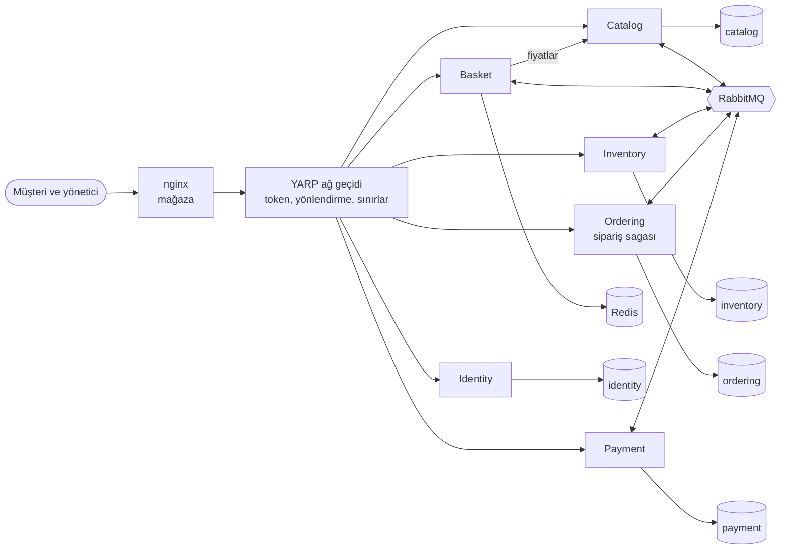

Her servisin kendi PostgreSQL veritabanı var (Compose'da tek sunucuda). Başka bir servisi doğrudan çağıran tek servis Basket; sepeti fiyatlamak için Catalog'a gider. Geri kalan her şey RabbitMQ üzerinden akar.

Ordering'in yürüttüğü sipariş sagası:

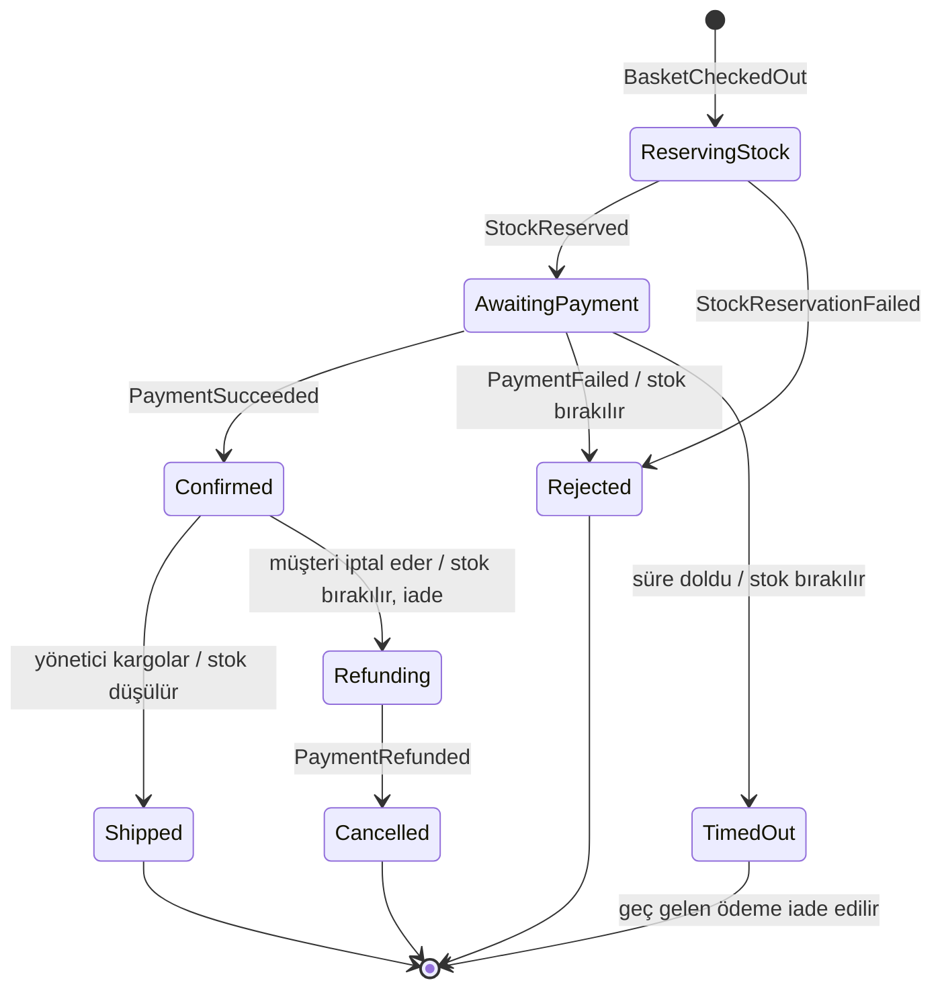

Baştan sona bir ödeme:

```mermaid
sequenceDiagram
    participant C as Müşteri
    participant B as Basket
    participant O as Ordering (saga)
    participant I as Inventory
    participant P as Payment
    C->>P: POST /cards (kart numarası) → token
    C->>B: POST /checkout (adres, gösterilen toplam, token)
    B->>B: Catalog'dan yeniden fiyatla; sepeti al
    B-)O: BasketCheckedOut (outbox)
    B-->>C: 202 sipariş kimliği
    O-)I: ReserveStock
    I-)O: StockReserved (tüm kalemler ya da hiçbiri)
    O-)P: ProcessPayment
    P-)O: PaymentSucceeded (4242 ile biten kart)
    O-->>C: sipariş sayfasında "Ödendi"
```

## Tasarım kararları

- **Servis başına veritabanı, ortak tablo yok.** Her servis yalnızca kendi verisini okur, diğerlerini olaylardan öğrenir. Inventory yeni ürünleri `ProductCreated` olayından öğrenir ve kendi ad ve SKU kopyasını tutar; stok sayfası Catalog'u çağırmaya ihtiyaç duymaz.
- **Olay zinciri yerine orkestrasyonlu saga.** Siparişin bütün süreci Ordering'de, kendi veritabanında saklanan tek bir MassTransit durum makinesi. Mutlu yol, her telafi adımı (stoğu bırak, ödemeyi iade et) ve zaman aşımı tek bir dosyada okunabilir. Inventory ve Payment yalnızca komutlara cevap verir; siparişlerin durumlarından haberleri yoktur.
- **Outbox: değişiklik ve mesajları birlikte kaydedilir.** Her servis giden mesajlarını kendi değişikliğiyle aynı işlemde bir outbox tablosuna yazar; arka planda bir teslimatçı onları gönderir. "Kaydedildi" ile "gönderildi" arasındaki bir çökme ne mesaj kaybettirir ne de geri alınmış bir değişiklik için mesaj gönderir. Veritabanı olmayan Basket sepeti Redis'ten tek atomik adımda (`GETDEL`) alır; böylece aynı anda yapılan iki ödeme tek sipariş oluşturur. Yayınlama başarısız olursa sepeti geri koyar.
- **Idempotent tüketiciler.** Inbox, işlenmiş bir mesajı düşürür. Bunun üstüne her işleyici iki kez çalışmaya dayanıklıdır: zaten stok ayrılmış bir sipariş için yeniden ayırmak hiçbir şey yapmaz; bir siparişin ödemesi tekildir, tekrarlanan `ProcessPayment` yeniden çekim yapmak yerine ilk sonucu döner.
- **Önemli satırları kilitleyerek fazla satışı önlemek.** Stok ayırma, siparişin stok satırlarını kilitler (`SELECT … FOR UPDATE`, kilitlenmeyi önlemek için sabit sırayla), her kalemi kontrol eder ve ya hepsini ayırır ya hiçbirini. Bir check constraint, kod yanlış olsa bile ayrılan miktarın eldeki stoğu aşmasını engeller.
- **Önce ayrılır, sonra düşülür.** Stok sipariş verilirken ayrılır, kargoya verilince raftan düşülür. İptal edilen, reddedilen ya da zaman aşımına uğrayan sipariş ayırmayı bırakır; raf sayısı yalnızca gerçekten çıkan mal için değişir.
- **Bir mesaja bağlı olmayan zaman aşımı.** Ödeme bekleyen bir siparişin saga satırında bir son tarihi vardır. Ordering içindeki bir süpürücü süresi geçen siparişleri bulur, zaman aşımına taşır ve stoğu bırakır. Bundan sonra gelen bir ödeme otomatik olarak iade edilir.
- **Müşterinin gördüğü fiyat, ödediği fiyattır.** Ödeme isteği, müşteriye gösterilen toplamı taşır. Basket kalemleri Catalog'dan yeniden fiyatlar; bir fark varsa sipariş vermek yerine değişikliklerle `409` döner. Siparişler ad ve fiyatların bir kopyasını tutar; katalog sonradan değişse de geçmiş yeniden yazılmaz.
- **Kartlar önce tokenize edilir.** Tarayıcı kartı Payment'a gönderir ve kısa ömürlü bir token alır. Sepet, sipariş ve mesajlar yalnızca bu token'ı taşır; yalnızca son dört hane saklanır.
- **Tek ağ geçidi, asimetrik token'lar.** Identity, token'ları yalnızca kendisinde bulunan bir RSA özel anahtarıyla imzalar. Ağ geçidi ve servisler açık anahtarla doğrular; ele geçirilmiş bir servis token üretemez. Ağ geçidi kimliği doğrulanmamış çağrıları servise ulaşmadan reddeder; her servis yine de token'ı ve rolü kendisi kontrol eder.
- **Hatalar yeniden denenir, sonra durur.** Mesaj işleyicileri 0,1, 0,5, 1, 2 ve 5 saniyede yeniden dener. Hâlâ başarısız olan mesaj, diğerlerini tıkamak yerine bir hata kuyruğuna gider. Basket'tan Catalog'a giden HTTP çağrılarında zaman aşımı, yeniden deneme ve devre kesici vardır. Catalog kapalıysa ödeme `503` döner ve sepet korunur.
- **Ortak sunucuya göre ayarlanmış bağlantı havuzları.** Yukarıdaki yoğunluk testi ilk denemede PostgreSQL'in bağlantıları tükendiği için başarısız oldu: varsayılan 100'lük havuzlarıyla beş servis, 100 bağlantıya izin veren bir sunucuya karşı. Compose'da her servis artık en fazla 30 bağlantı tutuyor, sunucu 200'e izin veriyor. Test CI'da kalıyor; sorun fark edilmeden geri gelemez.
- **Gerçek altyapıyla testler.** Entegrasyon testleri her servisi Testcontainers içindeki PostgreSQL, Redis ve RabbitMQ'ya karşı çalıştırır. Saga testleri gerçek bir RabbitMQ'da sahte bir saatle çalışır; zaman aşımları beklemeden test edilir.

## Komutlar

| Komut | Ne yapar |
|---|---|
| `docker compose up --build` | Mağazanın tamamı http://localhost:8080 adresinde |
| `dotnet test` | .NET birim ve entegrasyon testleri (Testcontainers için Docker gerekir) |
| `cd web && npm install && npm test` | Mağaza arayüzünün birim testleri |
| `cd web && npm run dev` | 8080 portundaki ağ geçidine bağlı, anında yenilenen arayüz http://localhost:5173 adresinde |
| `cd tests/e2e && npm install && node shop.mjs` | `AUTH_ATTEMPTS_PER_MINUTE=1000` ile başlatılmış yığına karşı tarayıcı senaryosu |
| `bash tests/resilience/run.sh` | `AUTH_ATTEMPTS_PER_MINUTE=100000 REQUESTS_PER_MINUTE=100000` ile başlatılmış yığına karşı dayanıklılık kontrolleri |
| `dotnet ef migrations add <Ad> --project src/Services/<Servis>/Shop.<Servis> --output-dir Data/Migrations` | Bir servise migration ekler |

Compose dışında yerel çalıştırmada her servis bağlantı dizesini ve anahtarlarını depodan değil, user secrets ya da ortam değişkenlerinden okur. `deploy/keys.sh`, Compose'un açılışta ürettiği RSA anahtar çiftini oluşturur.

## Testler

132 test ve yığının tamamına karşı iki çalıştırma: 125 .NET birim ve entegrasyon testi, mağaza arayüzü için 7 Vitest testi, 13 adımlık bir Playwright senaryosu ve dayanıklılık kontrolleri; hepsi CI'da.

- **Identity:** kayıt, her hatada aynı cevabı veren giriş, açık anahtarla doğrulanan RS256 token'lar, yapılandırmadan gelen yönetici, loglarda e-posta ve kart numarası maskeleme.
- **Catalog:** arama, filtreler, sıralama ve sayfalama, slug'lar, müşteriden gizlenen arşivli ürünler, sürüm kontrollü yönetici değişiklikleri, outbox üzerinden `ProductCreated`.
- **Basket:** adetler ve toplamlar, Catalog'dan fiyatlar, fiyatlar değiştiğinde değişikliklerle reddedilen ödeme, aynı anda iki ödemenin tek sipariş oluşturması, adres ve kart doğrulama, Catalog kapalıyken hiçbir şeyin sipariş edilmemesi ve sepetin korunması.
- **Inventory:** yeni ürünler için açılış stoğu, tüm kalemleri ya da hiçbirini ayırma, son beş ürün için paralel yirmi siparişin tam beş satması, bırakma ve düşme, tekrarlanan mesajların iki kez ayırmaması, ayrılan miktarın altına inemeyen sayımlar.
- **Ordering:** gerçek RabbitMQ'da saga: ödendi, stok yok, stoğu geri veren red, geç gelen ödemenin iade edildiği zaman aşımı, iadeli iptal, stoğu düşen kargolama, iki kez teslim edilen ödeme isteği ya da ödeme cevabı ve siparişlerin yalnızca sahibine görünmesi.
- **Payment:** kart token'ları (Luhn, son kullanma, tek kullanım, tek müşteri, yarım saat), test kartları, iki kez istense de sipariş başına tek çekim, yalnızca başarılı ödemeye ve yalnızca bir kez iade.
- **Gateway:** yönlendirme, iletmeden önce token kontrolü, bilinmeyen yolların iletilmemesi, giriş sınırı, korelasyon kimlikleri, her servisin API dokümanı ve kapalı servisi adıyla bildiren hazır olma kontrolü.
- **Mağaza arayüzü (Vitest):** lira biçimi, kart biçimlendirme, son kullanma tarihi ayrıştırma, sipariş ilerlemesi.
- **Tarayıcılar (CI):** gezinme ve arama, sepetten kayıt, adetler, ödeme, reddedilen kart, yöneticinin takip koduyla kargolaması, müşterinin bunu görmesi, iadeli iptal, ödemeden önce gösterilen fiyat değişikliği, stok sayımı, müşterinin yönetim sayfalarına girememesi, telefon görünümü ve betik hatası olmaması.
- **Dayanıklılık (CI):** yukarıdaki tablo.

## Yol haritası ve bilinen eksikler

- Bir sağlayıcının test ortamı üzerinden gerçek ödemeler; buradaki kart sağlayıcı test kartlarıyla çalışan bir taklit.
- [notification-service](https://github.com/Beratoguzhan620/notification-service) üzerinden sipariş e-postaları.
- Parçalı kargolama ve kargodan sonra iade.
- PostgreSQL `ILIKE` yerine bir arama motoruyla arama.
- Kubernetes manifest'leri; Compose her şeyin tek kopyasını tek makinede çalıştırır.
- Hız sınırları ağ geçidinin belleğinde; birden çok ağ geçidiyle Redis'e taşınmalı.

## Lisans

[MIT](LICENSE) · Berat Oğuzhan Turğut · [GitHub](https://github.com/Beratoguzhan620)
